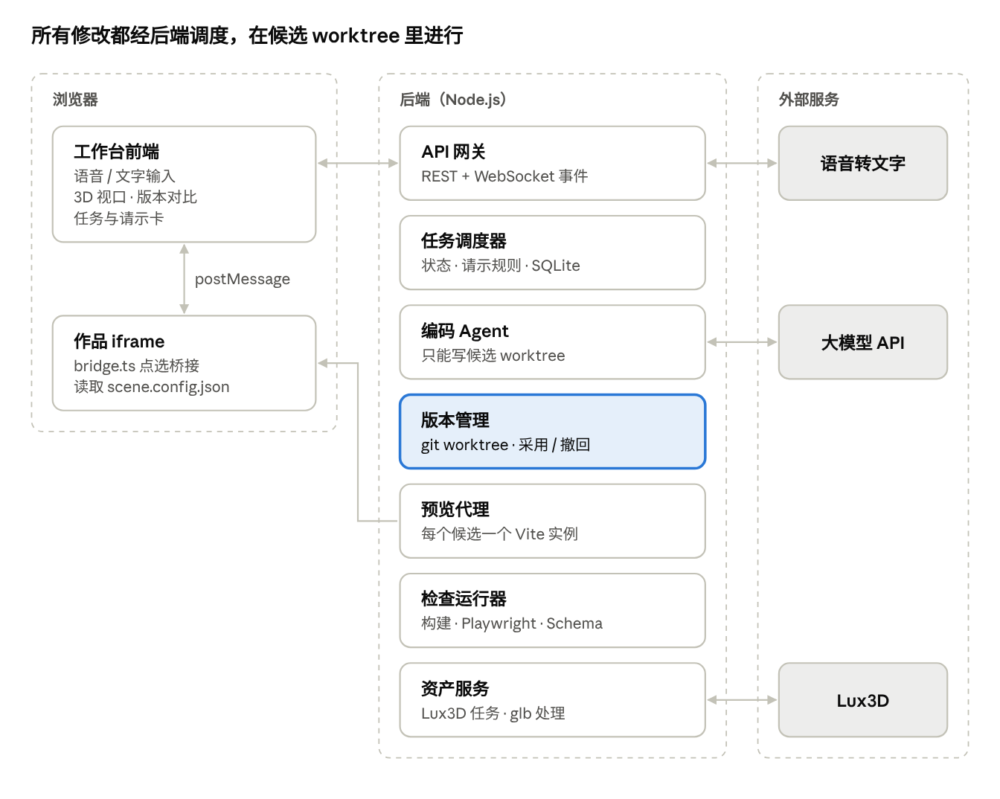
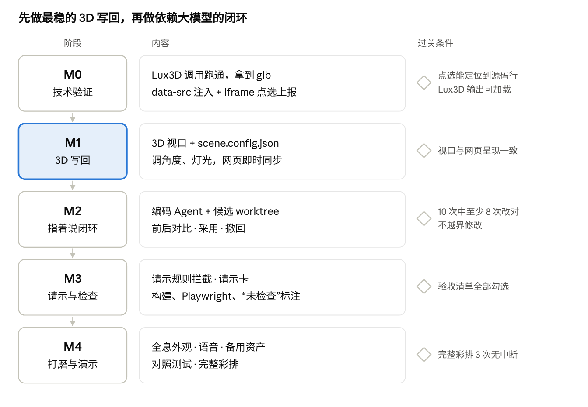

# 空间化 AI 创作工作台 · 开发文档 v0.1
Nov 8, 2026 · @soren
## 范围
MVP 只做一件事：让“指着说 → 候选版本 → 对比 → 采用/撤回”和“3D 调整 → 写回网页”两条链路在演示时可以重复、稳定地跑通。
做
工作台自己生成的单页网页（React + Vite 模板），在同源 iframe 里运行。
点选页面元素，定位到组件和源码行。
语音（按住说话）+ 文字输入。
单个编码 Agent，生成候选版本；前后对比，采用或撤回。
Lux3D 生成模型 → 工作台 3D 视口检查 → 加入网页。
在 3D 视口里调相机、灯光、缩放，写回网页配置文件。
请示卡：涉及共享组件或全局样式的修改必须经用户批准。
基本检查：构建是否通过、Playwright 冒烟测试、按钮是否被遮挡。
不做
第三方网站、多页应用、后端和数据库。
多 Agent 协作、AI 小人形象。
网页层级的 3D 展开（只作为可选彩蛋，有余力再做）。
发布上线、付款、账号体系。
## 技术选型
全部采用 Web 技术栈，不用 Unity。原因是作品本身就是网页：工作台和作品同在浏览器里，iframe 桥接和 3D 参数写回都最直接；Unity 要额外解决网页嵌入和交互桥接。
| 模块 | 选型 | 说明 |
| 工作台前端 | React + TypeScript + Vite | 全息风格只用在外围面板，中央作品区保持不透明 |
| 工作台 3D 视口 | Three.js + @react-three/fiber + drei | OrbitControls、TransformControls、灯光控件 |
| 作品模板 | React + Vite 单页 | 内置 3D 组件，读取 scene.config.json |
| 源码定位注入 | 自写 Babel/Vite 插件 | 可参考 code-inspector-plugin、React Grab 的做法 |
| 后端 | Node.js + Fastify + WebSocket | 任务、版本、事件推送 |
| 版本管理 | git，每个候选版本一个 worktree | 采用 = 合并，撤回 = 丢弃 worktree |
| 候选预览 | 每个 worktree 启动独立 Vite dev server | 经后端反向代理到同源路径 |
| 编码 Agent | 大模型 API + 受限工具集 | 只能读写候选 worktree 内的文件 |
| 语音 | 按住说话 + 语音转文字 API | 浏览器 Web Speech API 作备用 |
| 测试 | Playwright | 冒烟测试 + 遮挡检测 + 截图 |
| 3D 生成 | Lux3D | 具体接口、输出格式、费用待确认 |
待定：语音转文字和编码用哪个模型服务，要看比赛提供的额度和规则。
## 系统架构与模块划分
模块划分 · 浏览器 2 个、后端 7 个、外部服务 3 个
工作台前端用 REST 发请求、用 WebSocket 收事件；作品 iframe 由预览代理提供，与工作台同源。所有 API key 都只在后端，所以语音转写也经后端调用。后端内部由任务调度器串联其余模块。
一次“指着说”修改的完整路径
前端收到 Selection + 指令，POST /tasks。
调度器创建候选 worktree，启动编码 Agent。
Agent 在 worktree 内修改文件。调度器比对请示规则，命中则暂停并发 approval.requested。
预览代理启动该候选的 Vite 实例，发 candidate.ready。
检查运行器跑构建与测试，逐项发 check.finished。
用户对比后采用（合并）或撤回（删除 worktree）。
## 对象映射方案
因为网页是工作台自己生成的，我们在构建时给每个 JSX 元素打上源码标记，点选时直接读标记，不靠视觉猜测。
1. 构建时注入
自写 Vite 插件（仅在开发模式启用），给每个原生 JSX 元素加两个属性：
<button data-src="src/components/BuyButton.tsx:12:5" data-cid="BuyButton">立即购买</button>
data-src：文件:行:列。
data-cid：最近的组件名。共享组件的所有实例共用同一个 data-src，查询它就能得到“会影响几处”。
2. iframe 桥接脚本
作品模板内置一个很小的 bridge.ts，负责悬停高亮、点选拦截和上报。工作台与作品同源（候选预览经后端反向代理），用 postMessage 通信。
3. 点选时发生的事
用户进入“选取模式”，桥接脚本拦截点击，不触发页面原有行为。
从点击目标向上找到最近的带 data-src 的元素。
上报：data-src、data-cid、元素文字、包围盒、关键计算样式、同 data-src 的实例数量，以及向上 3 层祖先的 data-src（布局类修改往往要改父容器）。
工作台显示选中框，并高亮所有同源实例。
用户说话后，把“选中对象 + 语音文字 + 源码片段 + 当前版本号”一起交给 Agent。
4. 不确定时如何处理
点中的元素没有 data-src（如第三方组件内部）：向上归到最近的有标记的父元素，并提示“已选中外层容器”。
元素由循环生成：标注“这是列表中的一项，修改会影响全部 N 项”。
源码已被改过、行号不对：以版本号校验，不匹配就先刷新预览。
## 3D 操作写回网页
3D 参数不让 AI 去改代码，而是直接写进一个结构化配置文件，网页的 3D 组件读取它。这样写回是确定的、可校验的、即时的。
配置文件 src/scene.config.json
{  "model": "/assets/diffuser-v2.glb",  "hero": {    "camera": { "position": [0.8, 0.6, 1.4], "target": [0, 0.15, 0], "fov": 35 },    "model": { "rotation": [0, 0.52, 0], "scale": 1.0 },    "lights": { "key": { "intensity": 1.2, "color": "#ffd9a8", "direction": [1, 1, 0.5] }, "ambient": 0.4 }  },  "scroll": [    { "at": 0.0, "model": { "rotation": [0, 0.52, 0] } },    { "at": 0.6, "model": { "rotation": [0, 1.8, 0] }, "parts": { "lid": { "offset": [0, 0.08, 0] } } }  ]}
交互流程
工作台 3D 视口加载同一个模型，用同一套渲染参数，保证“所见即所得”。
用户用鼠标旋转相机、拖动灯光手柄、调色温滑块。
用户说“首屏就用这个”或点“设为首屏”→ 当前参数写入 hero。
用户说“滚动到这里时…”→ 先在网页里点选位置取得滚动进度，再把当前姿态写入 scroll 关键帧。
配置写入候选 worktree，Vite 热更新，网页预览即时变化；工作台展示参数 diff。
注意
这条链路完全不过大模型，是 Demo 最稳的一环，应最先做通。
“瓶盖打开”依赖模型已拆分出独立部件（lid）。Lux3D 拆部件是否可用、部件名如何得到，需要先验证；不可用就只做旋转关键帧。
用 JSON Schema 校验配置，防止写入非法值导致页面白屏。
## 候选版本、任务与请示卡数据模型
任务完成、用户批准、版本采用是三件不同的事，分别记录。所有状态存在后端 SQLite 里，前端只显示。
type Selection = {  src: string;            // "src/components/BuyButton.tsx:12:5"  cid: string;            // "BuyButton"  text?: string;  bbox: [number, number, number, number];  instances: number;      // 同 src 的实例数  ancestors: string[];    // 祖先 src  baseVersion: string;    // 点选时的 git commit};type Task = {  id: string;  instruction: string;    // 语音转写或文字  selection?: Selection;  status: "queued" | "running" | "awaiting_approval" | "done" | "failed" | "cancelled";  candidateId?: string;  events: TaskEvent[];    // 可追溯的步骤记录};type Candidate = {  id: string;  baseVersion: string;  branch: string;         // git worktree 分支  previewUrl: string;     // "/preview/<id>/"  diff: FileDiff[];  checks: Check[];  decision: "pending" | "adopted" | "discarded";};type Check = {  name: "build" | "smoke" | "occlusion" | "schema";  status: "passed" | "failed" | "not_run";   // 未运行必须显示 not_run  evidence?: string;      // 截图或日志路径};type ApprovalCard = {  id: string;  taskId: string;  question: string;       // 决定什么  reason: string;         // 为什么需要请示  options: { label: string; impact: string }[];  affected: string[];     // 受影响的 src / 文件  answer?: { option: number; at: string };};
触发请示的规则（由执行层判断，不靠 Agent 自觉）
修改的文件被 2 处以上引用（共享组件）。
修改全局样式、主题变量或 package.json。
修改的文件不在本次选中对象及其祖先的文件范围内。
任何对外操作（网络请求、发布）——MVP 中直接禁止。
## 接口与事件协议
三条通道：iframe ↔ 工作台用 postMessage，工作台 → 后端用 REST，后端 → 工作台用 WebSocket 推送事件。
iframe 桥接消息
| 方向 | type | 内容 |
| 工作台 → 作品 | pick:start / pick:stop | 进入或退出选取模式 |
| 工作台 → 作品 | highlight | { src }，高亮所有同源实例 |
| 作品 → 工作台 | pick:result | Selection（不含 baseVersion，由工作台补） |
| 作品 → 工作台 | scroll:progress | { at: 0–1 }，用于滚动关键帧 |
| 作品 → 工作台 | ready / error | 页面加载完成或运行时报错 |
REST
| 方法 | 路径 | 作用 |
| POST | /tasks | 新建任务：{ instruction, selection? } |
| POST | /tasks/:id/cancel | 停止任务 |
| POST | /candidates/:id/adopt | 采用候选版本（合并到主干） |
| POST | /candidates/:id/discard | 撤回候选版本 |
| POST | /approvals/:id | 回答请示：{ option } |
| PUT | /scene | 写入 3D 配置（先经 Schema 校验） |
| POST | /assets/lux3d | 提交 Lux3D 生成任务 |
WebSocket 事件
task.updated、candidate.ready、check.finished、approval.requested、asset.progress、asset.ready、version.changed。每个事件带 ts 和序号，前端断线重连后从最后序号补拉。
## Lux3D 集成与备用资产
Lux3D 只负责生成模型。工作台负责提交任务、等待、下载、转换和接入网页。
提交：用户确认概念图后，后端调用 Lux3D，记录任务 ID、输入、提交时间。
等待：后端轮询状态，通过 asset.progress 推送；用户可以继续其他操作。重试前先查询状态，避免重复提交产生重复费用。
下载与处理：统一转成 .glb；用 gltf-transform 压缩纹理与网格，控制网页加载体积；归一化尺寸和原点，让默认相机参数可用。
检查：用户在 3D 视口里旋转确认。采用后复制到作品 public/assets/，并更新 scene.config.json 的 model 字段。
备用资产
赛前用同样的提示生成 2–3 个模型，放在 fallback/。演示中若现场生成未完成，切换到备用，并在界面上标出“备用资产，生成于赛前”。如果比赛规则要求现场生成，就按规则执行。
待确认：Lux3D 的调用方式（API 或网页端）、输出格式、典型等待时长、拆部件能力、费用和参赛使用条款。这些在里程碑 M0 中先验证。
## 安全与权限
权限由执行层强制，提示词里写“请先请示”不算数。
文件范围：Agent 的写文件工具只接受当前候选 worktree 内的路径；路径在后端规范化后再校验，防止 ../ 逃逸。
不给 shell：Agent 不能运行任意命令。构建、测试由后端按固定脚本执行。
不动正式版本：所有修改先在候选分支上，只有用户点“采用”才合并。
依赖变更要请示：改 package.json 必须经请示卡；MVP 中禁止安装新包。
不重复执行外部动作：Lux3D 提交等有费用的调用带幂等键。
可停止、可撤回：任何任务可取消；任何已采用版本可回退到上一个 commit。
数据去向：界面上注明语音、代码、图片会发送到哪些第三方服务。
密钥：API key 只存后端环境变量，不进前端、不进作品代码。
## 里程碑与分工
里程碑 · 5 个阶段，每段一个过关条件
M1 不依赖大模型，最先做通，保证 Demo 至少有一个稳定的亮点。M0 未过关就不要往下做，先调整方案。具体日期按比赛时间表倒推。
建议分工（按角色，人数少时可兼任）
| 角色 | 负责模块 |
| 前端 / 3D | 工作台界面、3D 视口、作品模板的 3D 组件、bridge.ts |
| 后端 / Agent | API 网关、调度器、编码 Agent、版本管理、预览代理、Vite 注入插件 |
| 资产 / 测试 | Lux3D 集成、备用资产、检查运行器、验收测试 |
| 设计 / 演示 | 全息视觉、演示脚本、对照测试组织、评委材料 |
## 验收标准与风险
验收标准（演示前必须全部达到）
☐ 在模板页面上随机点选 20 个元素，定位到的源码行全部正确。
☐ “指着说 → 候选 → 采用”连续跑 10 次，至少 8 次一次改对，且没有修改到选中范围以外的文件。
☐ 单次修改从说完话到候选预览可见，等待时间在演示可接受范围内（目标待团队定）。
☐ 撤回后页面和源码完全恢复。
☐ 3D 视口里的角度、灯光与网页呈现一致。
☐ 改共享组件时一定弹出请示卡；未批准前不产生候选版本。
☐ 未运行的检查显示为“未检查”，从不显示为通过。
☐ 断网或大模型超时时，界面显示失败并可重试，不卡死。
风险清单
| 风险 | 影响 | 应对 |
| 大模型改错或改太多 | 演示翻车 | 限制可改文件范围；提前测好演示用的几句指令 |
| Lux3D 等待太久或失败 | 3D 环节断掉 | 开场就提交；备用资产并如实标注 |
| 模型没有可拆分的瓶盖 | “瓶盖打开”做不了 | 降级为旋转关键帧 |
| 语音识别在现场噪音中出错 | 指令错误 | 转写文字先显示、可编辑再提交；保留文字输入 |
| 多个 Vite 实例占内存 | 预览变慢 | 同时最多保留 3 个候选，旧的自动关闭 |
| 全息风格影响可读性 | 评委看不清作品 | 作品区不透明，全息只用在外围 |

## 里程碑（图片内容的文字版）
| 阶段 | 内容 | 过关条件 |
| M0 技术验证 | Lux3D 调用跑通，拿到 glb；data-src 注入 + iframe 点选上报 | 点选能定位到源码行；Lux3D 输出可加载 |
| M1 3D 写回 | 3D 视口 + scene.config.json；调角度、灯光，网页即时同步 | 视口与网页呈现一致 |
| M2 指着说闭环 | 编码 Agent + 候选 worktree；前后对比 · 采用 · 撤回 | 10 次中至少 8 次改对，不越界修改 |
| M3 请示与检查 | 请示规则拦截 · 请示卡；构建、Playwright、“未检查”标注 | 验收清单全部勾选 |
| M4 打磨与演示 | 全息外观 · 语音 · 备用资产；对照测试 · 完整彩排 | 完整彩排 3 次无中断 |
