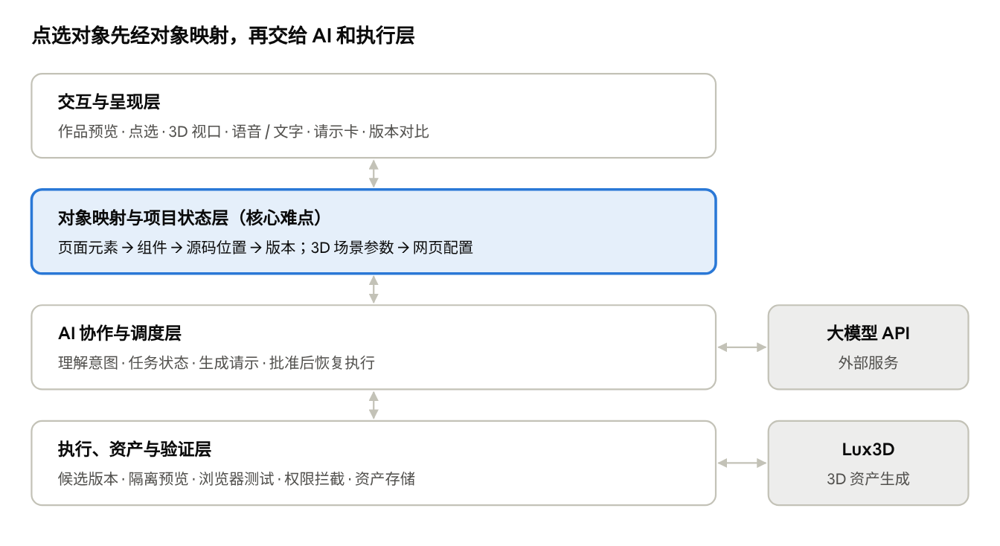

# 空间化 AI 创作工作台 · 项目简介
Nov 8, 2026 · @soren
## 一句话
指着作品说话，AI 帮你改。
一个以真实作品为中心的 AI 创作工作台：非程序员用语音、点选和直接的 3D 操作，与 AI 一起做出可运行的网页，并在作品上逐处打磨。
## 要解决的问题
今天的 AI 开发以聊天为中心。非程序员知道“这里不对”，却说不清是哪个组件、什么原因；每轮修改都要重新描述上下文，结果常常误改别处，也看不清 AI 改了什么、测过什么。
我们的主张是 让表达回到作品本身。用户指着真实对象说话，AI 拿到的是精确的对象和源码位置，而不是一段模糊的描述。
## 核心交互
工作台只做两件事，都把用户的操作变成真实代码。
1. 指着说（Point & Speak）
用户在真实运行的网页上点中一个按钮，说“这个挡住商品了，往下挪一点”。系统已知这个按钮对应哪个组件、哪个文件、哪个版本，AI 在候选版本里修改，用户对比后采用或撤回。若改动会影响其他地方，页面上同时高亮所有受影响的位置。
这一交互传承自 1980 年 MIT 的 “Put-That-There”：说话加指点，比单独说话更精确。我们把它带进 AI 开发。
2. 在 3D 里调，写回网页
商品的 3D 模型由 Lux3D 生成。用户在工作台里直接旋转、摆放、调灯光，说“首屏就用这个角度”，系统把相机、灯光、缩放参数写进网页代码，真实页面立即更新。“滚动到这里时瓶盖打开”也一样：用户摆出姿态，系统记为滚动动画关键帧。
这类调整用语言很难说清，用手却很自然。3D 在这里是唯一合适的表达方式，而不是装饰。
重大决定用“请示卡”
授权范围内的工作 AI 持续推进；遇到重大选择（换整体风格、改共享组件、发布），执行层会真的拦住，并弹出一张卡片说明决定什么、有哪些选项、各自影响什么。用户批了才继续。
## Demo 演示流程（约 5 分钟）
一条闭环，核心环节当场重复两次。
开场（0:00）：用户说“做一个温暖风格的香薰商品页”。助手展示简短蓝图；同时后台提交 Lux3D 生成“木盖香薰瓶”。
初版（0:40）：真实网页在中央作品区运行，任务区显示真实状态。
指着说（1:20）：点中“立即购买”按钮，说“这个挡住商品了，往下挪一点”。生成候选版本 → 前后对比 → 采用。
再来一次（2:10）：点中标题，说“字体换成更手写的感觉”。不满意 → 撤回，证明可逆。
3D 资产（2:40）：模型已生成。用户旋转检查，确认采用，模型加入首屏。
在 3D 里调（3:20）：把瓶子转到满意角度、把灯光调暖，说“首屏用这个”。网页代码更新，屏幕上同时显示改动的参数。
请示卡（4:00）：用户说“把所有按钮都换成圆角”。因涉及共享组件，弹出请示卡，高亮 3 处受影响位置，用户批准。
收尾（4:30）：展示最终作品、已运行的检查、尚未检查的事项，以及对照测试结果。
## 系统架构
系统架构 · 4 层 + 2 个外部服务
自研的重点是第二层：只有先把“用户指的东西”可靠地对应到源码，AI 的修改才不会偏。Lux3D 和大模型是外部服务，工作台负责把它们的结果接入真实作品。
## 我们如何验证
核心假设是“围绕作品指着说，比单纯聊天更容易改对”。比赛期间做一个小样本对照测试来初步检验。
参与者：3–5 名非程序员。
任务：同一个网页，完成 3 处指定修改（挪按钮、改标题风格、调商品展示角度）。
对照：A = 聊天框 + 网页预览；B = 本工作台。参与者交替顺序使用。
记录：完成时间、说了几轮、误改次数、主观难度（1–5 分）。
样本很小，只能作为方向性信号，不作结论。结果无论好坏都如实展示。
## 诚实边界
演示中每一项都会标清来源。
| 环节 | 谁负责 | 演示方式 |
| 3D 模型生成 | Lux3D | 现场提交；另备一份预生成模型，若使用则标明“备用” |
| 网页生成与修改 | 工作台 + 大模型 API | 现场实时调用 |
| 对象映射（点选 → 源码） | 工作台自研 | 现场 |
| 3D 参数写回网页 | 工作台自研 | 现场 |
| 候选版本、对比、撤回 | 工作台自研 | 现场 |
| 请示卡与权限拦截 | 工作台自研 | 现场 |
| 测试结果 | 工作台调用浏览器测试 | 只显示真实运行的结果，未运行的标为“未检查” |
第一版不做：编辑第三方网站、脚本和后端类任务、多 Agent 展示、发布上线。我们也不宣称“做网页必须用 3D”：3D 只用在它确实更好用的地方。

